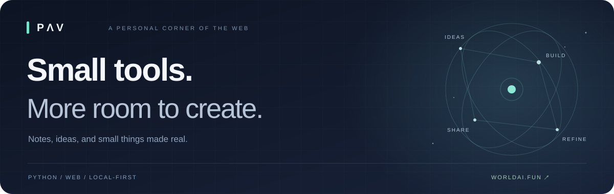
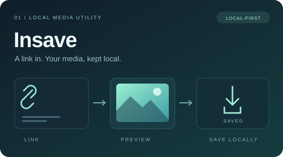
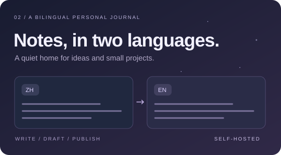
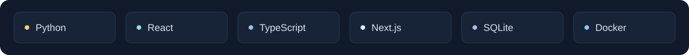

[← 简体中文 / Bilingual profile](README.md) · **English**

### Turn ideas into notes. Turn everyday friction into useful tools.

[Website](https://www.worldai.fun) &nbsp; · &nbsp; [Practical Toolbox](https://github.com/NanStars/practical-toolbox) &nbsp; · &nbsp; [Repositories](https://github.com/NanStars?tab=repositories)

## 01 — About me

Hi, I'm **PΛV**. This is a home for everyday experiments, learning notes, and small utilities. I like starting with a concrete problem: making things easier to organise, giving ideas a place to live, and reducing repetitive work.

<table>
<tr>
<td width="33%" valign="top">

### Small, but considered
Solve one real problem before adding another feature.

</td>
<td width="33%" valign="top">

### Local-first thinking
Care about local workflows, privacy boundaries, and understandable deployment.

</td>
<td width="33%" valign="top">

### Built to be understood
Share the context, usage, limitations, and checks—not just the code.

</td>
</tr>
</table>

## 02 — Things I've been building

Two projects with a shared direction: **small, practical, and self-hostable.**

<table>
<tr>
<td width="50%" valign="top">

### Insave
**Share links. Preview media. Keep it local.**

Parse Instagram / Douyin share links, preview images and videos, then save individual files or a ZIP. Runs locally by default; use it only for content you own or have permission to save.

`Python` `React` `Vite`

[Source →](https://github.com/NanStars/practical-toolbox/tree/main/ins-downloader) · [Usage guide](https://github.com/NanStars/practical-toolbox/blob/main/ins-downloader/README.md)

</td>
<td width="50%" valign="top">

### PΛV Journal
**A quiet place for notes, ideas, and small projects.**

A bilingual personal blog with independently maintained Chinese and English content, a starfield, an admin editor, a draft-to-publish workflow, and Docker / NAS deployment configuration.

`Next.js` `TypeScript` `SQLite` `Docker`

[Source →](https://github.com/NanStars/practical-toolbox/tree/main/pav-blog-bilingual) · [Deployment](https://github.com/NanStars/practical-toolbox/blob/main/pav-blog-bilingual/README.md)

</td>
</tr>
</table>

Project workflow illustrations.

### More places to explore

| Collection | What you'll find |
| :--- | :--- |
| **[Practical Toolbox](https://github.com/NanStars/practical-toolbox)** | Source, independent setup instructions, and self-hosting guides for small utilities. |
| **[PythonCreation](https://github.com/NanStars/PythonCreation)** | A collection of everyday Python creations and experiments. |

## 03 — Technologies in the projects

From local scripts to web interfaces and lightweight self-hosted deployment.

## 04 — What I care about

- **Clear boundaries.** Explain what a tool does, what it doesn't, and where it may fail.
- **Deliberate data handling.** Keep credentials, cookies, private drafts, and runtime data out of public source.
- **Room to improve.** Keep tests, documentation, and verification notes as a starting point for the next iteration.

## 05 — Beyond code

The website is a home for everyday notes, things I learn, and small discoveries along the way.

**Let tools handle the repetition. Make room for what matters.**

PΛV · Stay curious. Keep refining.

