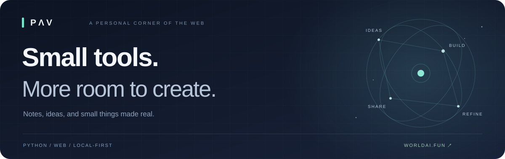
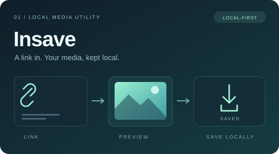
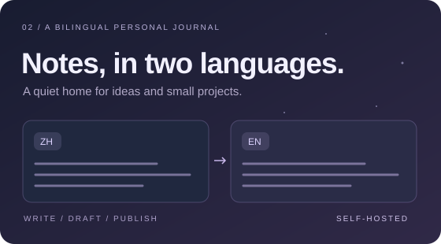
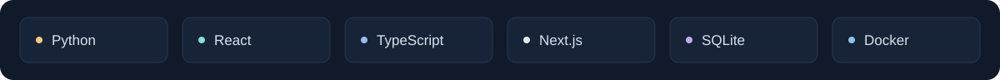

**简体中文 / English** · [English edition →](README.en.md)

### 把想法写下来，把小问题做成工具。
**Turn ideas into notes. Turn everyday friction into useful tools.**

[个人网站 / Website](https://www.worldai.fun) &nbsp; · &nbsp; [实用工具箱 / Toolbox](https://github.com/NanStars/practical-toolbox) &nbsp; · &nbsp; [全部仓库 / Repositories](https://github.com/NanStars?tab=repositories)

## 01 — 关于我 / About me

你好，我是 **PΛV**。这里是我放置日常创作、学习笔记和实用小工具的地方。我喜欢从具体的小问题出发：让资料更容易整理，让内容有自己的归处，让重复操作少一点。

Hi, I'm **PΛV**. This is a home for everyday experiments, learning notes, and small utilities. I like starting with a concrete problem: making things easier to organise, giving ideas a place to live, and reducing repetitive work.

<table>
<tr>
<td width="33%" valign="top">

### 做小，也做好 Small, but considered

不急着堆功能，先把一个真实问题解决清楚。

Solve one real problem before adding another feature.

</td>
<td width="33%" valign="top">

### 数据留在自己手里 Local-first thinking

关注本地运行、隐私边界与清楚的部署方式。

Care about local workflows, privacy boundaries, and understandable deployment.

</td>
<td width="33%" valign="top">

### 留下可读的过程 Built to be understood

不仅分享代码，也整理用法、限制和验证记录。

Share the context, usage, limitations, and checks—not just the code.

</td>
</tr>
</table>

## 02 — 正在做的东西 / Things I've been building

两个项目，一个共同方向：**轻量、实用、可以自己运行。**

Two projects with a shared direction: **small, practical, and self-hostable.**

<table>
<tr>
<td width="50%" valign="top">

### Insave · 媒体保存小工具
**Share links. Preview media. Keep it local.**

识别 Instagram / 抖音分享链接，预览图片和视频，单项保存或打包下载。默认在本机运行，只保存自己拥有或已获授权的内容。

Parse Instagram / Douyin share links, preview images and videos, then save individual files or a ZIP. Runs locally by default; use it only for content you own or have permission to save.

`Python` `React` `Vite`

[查看源码 / Source →](https://github.com/NanStars/practical-toolbox/tree/main/ins-downloader) · [使用说明 / Guide](https://github.com/NanStars/practical-toolbox/blob/main/ins-downloader/README.md)

</td>
<td width="50%" valign="top">

### PΛV Journal · 中英双语博客
**A quiet place for notes, ideas, and small projects.**

中英内容分别维护，配有动态星空、管理后台、草稿与发布流程，以及 Docker / NAS 部署配置。

A bilingual personal blog with independently maintained Chinese and English content, a starfield, an admin editor, a draft-to-publish workflow, and Docker / NAS deployment configuration.

`Next.js` `TypeScript` `SQLite` `Docker`

[查看源码 / Source →](https://github.com/NanStars/practical-toolbox/tree/main/pav-blog-bilingual) · [部署说明 / Deployment](https://github.com/NanStars/practical-toolbox/blob/main/pav-blog-bilingual/README.md)

</td>
</tr>
</table>

项目流程示意 / Project workflow illustrations.

### 也可以从这里开始 / More places to explore

| 入口 / Collection | 里面有什么 / What you'll find |
| :--- | :--- |
| **[Practical Toolbox](https://github.com/NanStars/practical-toolbox)** | 实用小工具的源码、独立启动方式和部署说明。 Source, independent setup instructions, and self-hosting guides. |
| **[PythonCreation](https://github.com/NanStars/PythonCreation)** | 日常关于 Python 的创作与尝试。 A collection of everyday Python creations and experiments. |

## 03 — 项目里用到的技术 / Technologies in the projects

从本地脚本到 Web 界面，再到轻量自托管部署。

From local scripts to web interfaces and lightweight self-hosted deployment.

## 04 — 我在意的事 / What I care about

- **让工具有明确边界。** 做什么、不做什么、哪些情况可能失败，都应该说清楚。 **Clear boundaries.** Explain what a tool does, what it doesn't, and where it may fail.
- **让数据有自己的归处。** 账号、Cookie、私人草稿和运行数据，不混进公开源码。 **Deliberate data handling.** Keep credentials, cookies, private drafts, and runtime data out of public source.
- **让项目可以继续打磨。** 保留测试、文档和验证记录，给下一次改进留一个清楚的起点。 **Room to improve.** Keep tests, documentation, and verification notes as a starting point for the next iteration.

## 05 — 代码之外 / Beyond code

网站里放日常记录、学习笔记，还有做东西时留下的小发现。

The website is a home for everyday notes, things I learn, and small discoveries along the way.

**把重复的事情交给工具，把时间留给真正想做的事。** 
Let tools handle the repetition. Make room for what matters.

PΛV · 保持好奇，慢慢打磨。 / Stay curious. Keep refining.

