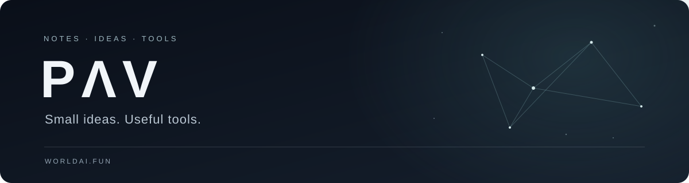

### 记录日常，整理思考，做一点真正用得上的小东西。

Notes, ideas, and small things made real.

**[个人网站 · worldai.fun](https://www.worldai.fun)** &nbsp; / &nbsp; **[实用工具箱](https://github.com/NanStars/practical-toolbox)** &nbsp; / &nbsp; **[所有项目](https://github.com/NanStars?tab=repositories)**

---

## About / 关于

你好，我是 **PΛV**。这里放一些日常创作、实用小工具，以及把想法变成可运行项目的过程。

- **实用优先** — 从具体的小问题出发，让重复的事情更简单。
- **本地优先** — 关注隐私边界、数据留存与清晰的使用说明。
- **慢慢打磨** — 用 Python 与 Web 技术持续尝试，也认真整理文档和部署方式。

I build small utilities with Python and web technologies, with an interest in local-first workflows and lightweight self-hosting.

## Selected projects / 项目

| 项目 | 简介 | 技术 |
| :--- | :--- | :--- |
| **[Practical Toolbox](https://github.com/NanStars/practical-toolbox)** | 日常实用小工具合集，附独立启动方式、测试与自托管说明。 | Python · TypeScript |
| ↳ **[Insave](https://github.com/NanStars/practical-toolbox/tree/main/ins-downloader)** | 在本机解析分享链接，预览并保存自己拥有或已获授权的图片与视频。 | Python · React · Vite |
| ↳ **[PΛV 双语博客](https://github.com/NanStars/practical-toolbox/tree/main/pav-blog-bilingual)** | 中英双语个人博客，包含动态星空、内容管理后台与 Docker 部署配置。 | Next.js · SQLite · Docker |
| **[PythonCreation](https://github.com/NanStars/PythonCreation)** | 日常关于 Python 的创作与尝试。 | 日常创作 |

## On the desk / 正在整理

**Python 小工具 · Web 界面 · 双语内容 · 轻量自托管**

不追求一次做得很大，先把一个小问题解决清楚，再慢慢完善。

---

**把重复的事情交给工具，把时间留给真正想做的事。**

[www.worldai.fun](https://www.worldai.fun)

